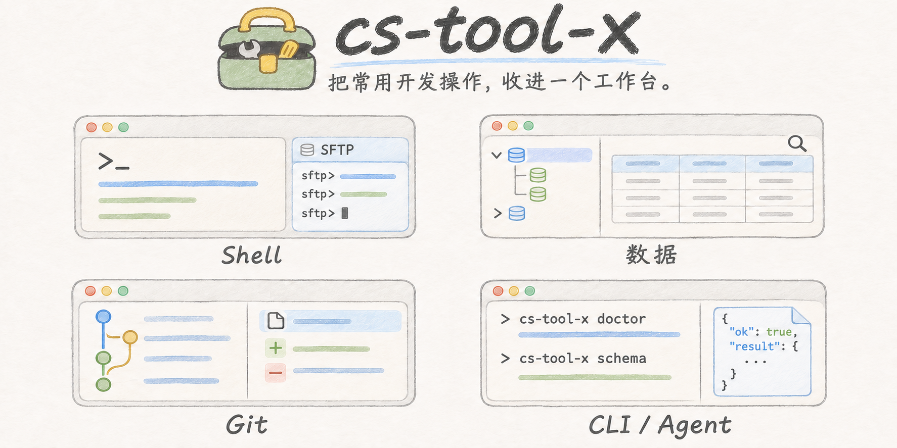
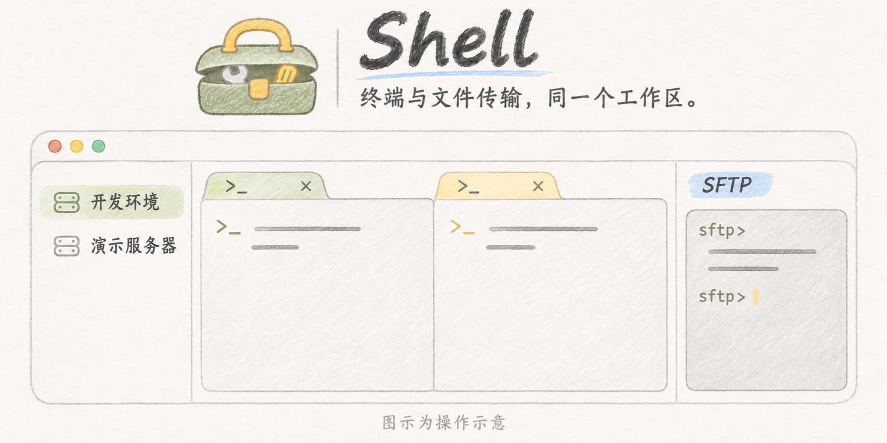
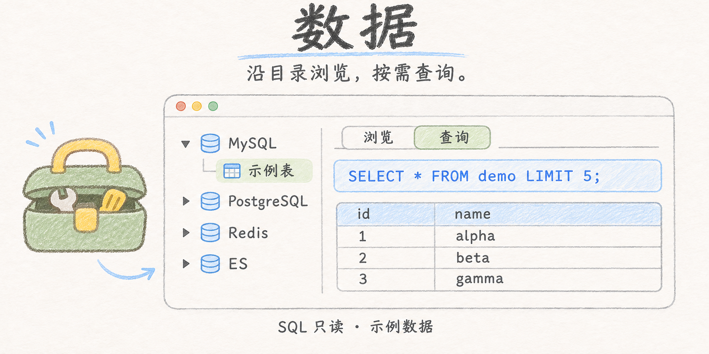
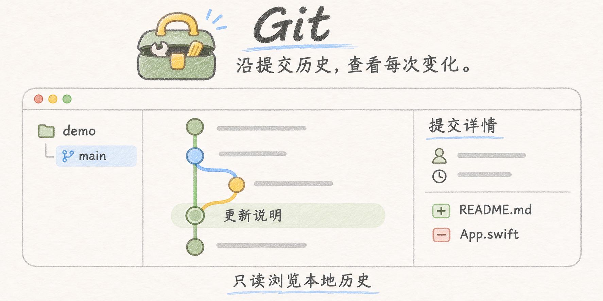
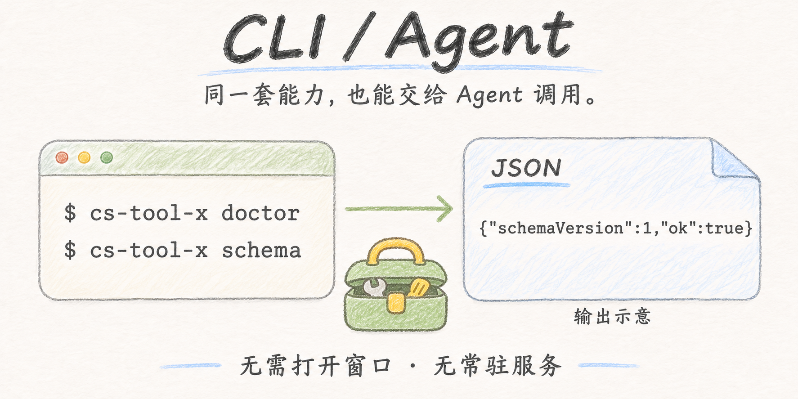

# cs-tool-x

  

  

  

  

  

  

原生 macOS 14+ / Apple Silicon。配图为功能示意，具体能力与限制以文档为准。

[下载最新版](https://github.com/anjing-le/cs-tool-x/releases/latest) · [开发与能力边界](docs/DEVELOPMENT.md) · [CLI / Agent 接入](docs/CLI.md) · [验证记录](docs/VALIDATION.md)
