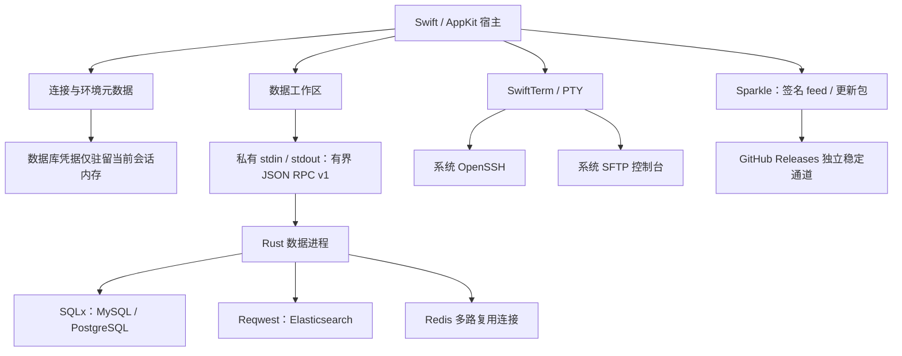

# 架构与模块边界

## 当前选择

macOS 14+ 的原生 Swift/AppKit 宿主，Rust 数据进程作为子进程按需启动。原来的 Tauri 原型不进入正式构建。

这个选择方便使用 AppKit 表格复用、SwiftUI 卡片与 Shell 布局、SwiftTerm 和 Sparkle。Rust 保留已验证的数据驱动与异步处理。代价是 Swift 与 Rust 两套工具链、显式维护跨进程协议，以及目前不提供跨平台 UI。该选择依据当前 macOS 范围，性能改善仍需测量。

## 模型与生命周期

- 工作区：独立交互区域，负责编辑状态、可见结果与模块动作。
- 连接配置：连接目标的元数据；与正在运行的会话分开，不含秘密字段。
- 数据库凭据：临时会话内存，不参与配置 JSON 和发布资产。SSH 密码按用户选择保存在本机 0600 shell.json，普通文本字段显示；只通过原生 askpass 回调传给 OpenSSH，不进入 argv/env 或发布资产。
- 会话：SQL 连接池、Redis 连接、HTTP Client 或 PTY。由用户建立与关闭，不因切换工作区被隐式重建。
- 任务：一次读取、查询或传输。拥有并发/时间/内存上限，以及当前会话的身份；未来取消必须核实服务端语义。
- 结果：有界的展示内容。数量截断、客户端超时、服务器取消是不同状态。

连接元数据目前由原生宿主管理；数据进程只拥有运行时会话和凭据。将来 SSH 隧道管理也是宿主级服务，数据适配器只接收实际回环端点，不直接读取用户 SSH 私钥。

## 进程协议 v1

每行一个 UTF-8 JSON 帧。请求 `{"id":1,"method":"hello","params":{}}`，响应 `{"id":1,"ok":true,"result":{...}}` 或 `{"id":1,"ok":false,"error":"..."}`。方法为 `hello` / `connect` / `run` / `disconnect`。连接 ID 由引擎生成，属于当前进程，不可跨重启复用。

最多 4 个运行任务；输入队列 4、输出队列 2；请求最多 256 KiB、响应最多 16 MiB。没有 localhost TCP 端口、浏览器桥接或通过 argv/env 传递密码。日志不输出请求内容和配置。父进程退出关闭管道，数据进程丢弃任务并释放连接；不将断开网络等同于数据库服务端已取消。

`hello` 的 protocol 数字用于版本协商。Swift 与 Rust 随同一个签名应用包升级，不支持独立自动下载任意引擎。后续修改协议需显式升级协议版本与兼容性检查。

## 模块扩展

第一阶段使用内置模块，共享基础接口和生命周期，不承诺第三方二进制插件 ABI。新增模块必须说明启动条件、持有资源、结果预算、取消/断开/退出行为、凭据范围和验收样例。接口/工具入口目前为规划状态，不会启动后台服务。

图形化文件模块将使用独立的有界传输适配器，不能依靠解析本地化 `ls` 输出完成文件模型。同步 libssh2 若被采用须在专属任务队列运行；其 Session 的阻塞调用会影响同 Session 其他通道，因此连接复用策略需要单独验证。

## 更新身份

产品显示名 `cs-tool-x`；正式 Bundle ID `cc.anjing.cs-tool-x`；开发包 `.dev`。正式与开发包使用分离的元数据配置空间；数据库连接均不保存凭据；SSH 密码可由用户选择明文保存在各自本机配置空间。OTA 私钥为仓库外、当前用户所有的 0600 本地文件，公钥与 macos-x 独立。应用使用 ad-hoc 完整性签名，不依赖代码签名钥匙串；更新来源由 Ed25519 归档/feed 签名认证。开发包关闭 OTA。

参考：[SwiftTerm](https://github.com/migueldeicaza/SwiftTerm)、[SQLx](https://docs.rs/sqlx/0.8.6/sqlx/)、[libssh2 Session 行为](https://docs.rs/ssh2/latest/ssh2/struct.Session.html)、[Sparkle 签名机制](https://sparkle-project.org/documentation/)。

## 界面复用

首页基于 anjing-financex 当前卡片布局重用：180pt 高、24pt 圆角、等宽自适应、减少动态效果支持。Shell 复用 anjing-shell 的服务器侧栏、同窗编辑面板、搜索语义、标签拖动和可调分屏，真实 PTY 由每块分屏自己的对象持有。切换标签/返回首页只卸载视图，关闭分屏/标签/退出负责释放进程。没有迁入原项目私有素材、示例服务器、模拟输出或假传输状态。图形文件栏显示明确待接入状态，并可进入 SFTP 控制台。
